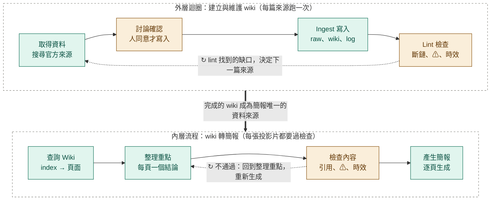

# 台灣垃圾分類 LLM Wiki
 
依 Andrej Karpathy 提出的 [LLM Wiki](https://gist.github.com/karpathy/442a6bf555914893e9891c11519de94f) 模式，由 LLM（Claude）以「先討論、後生成」的方式，把 5 份台灣政府資料整理成 34 頁互相連結的 markdown 知識庫，再用這個 wiki 製作一份給初學者的教學簡報。
 
- **主題**：台灣垃圾分類。涵蓋法定五類垃圾、資源回收物品、回收前處理、危險物品、廚餘養豬禁令（2027-01-01 起全面禁止）、居家針頭與藥品、縣市差異。
- **資料截至**：2026-11-10。實際規定請以所在縣市環保局公告為準。

## 工作流程
 

 
另外兩條回頭的路：
 
- ↻ 檢查時發現 wiki 本身缺資料：回外層，補 ingest 後再做簡報
- ↻ 好的查詢整理：存回 wiki 成為新頁面
| 顏色 | 意思 |
|---|---|
| 綠色框 | 生成步驟 |
| 橘色框 | 檢查閘門 |
 

## 線上瀏覽
 
| 成果 | 連結 |
|---|---|
| Wiki 網站 | https://r26144047-cyber.github.io/Garbage-LLM-Wiki/ |
| 教學簡報 | https://r26144047-cyber.github.io/Garbage-LLM-Wiki/slides.html |

## 檔案結構
 
```
garbage-wiki/
├── README.md
├── AGENTS.md        ← 給 LLM 代理人的操作說明：開工與收工流程、ingest／query／lint 步驟、來源政策
├── SCHEMA.md        ← 內容規則：頁面類型、命名、frontmatter、引用格式、⚠ ◇ ✔ 標記
├── index.md         ← 全部頁面的目錄與一句話摘要
├── log.md           ← 更新紀錄，格式：## [2026-11-10] ingest | 標題
├── raw/             ← 原始資料筆記（S1–S5），只讀不改
├── wiki/
│   ├── sources/     ← 每篇來源的摘要頁（S1–S5）
│   ├── categories/  ← 分類類別：巨大垃圾、有害垃圾、廚餘、資源垃圾、一般垃圾
│   ├── items/       ← 物品：紙類（含鋁箔包）、塑膠類（含寶特瓶）、保麗龍、鋰電池、感熱紙發票、居家針頭…（「這東西丟哪？」）
│   ├── concepts/    ← 概念：法定五類與日常三類、回收前處理
│   ├── law/         ← 政策與地區：法規沿革、廚餘養豬禁令、各地差異
│   └── maintenance/ ← 健康檢查（lint）報告
└── scripts/         ← lint.py（結構檢查）、build.py + template.html（產生網站）
```
 
## 資料來源
 
| 編號 | 來源 | 發布單位 |
|---|---|---|
| S1 | 《一般廢棄物回收清除處理辦法》（114 年 1 月 3 日修正） | 環境部 |
| S2 | 〈一般廢棄物回收項目排出方式〉 | 環境部資源回收網 |
| S3 | 〈廚餘該怎麼分類〉（廚餘禁令前發布） | 環境部 |
| S4 | 〈2027 年全面禁止廚餘養豬專案報告〉（2025-12-15） | 環境部向立法院報告 |
| S5 | 居家針頭與廢藥品的處理 | 環保署常見問題、臺北市環保局；部分為媒體轉述（標 ◇） |
 
## 標記
 
| 標記 | 意思 |
|---|---|
| ⚠ | 資料未確定，待找到官方說明 |
| ◇ | 依據非官方來源（媒體、學校、公會），待替換為政府原文 |
| ✔ | 原本的疑點已釐清，並寫明依據 |
 
## 維護方式
 
新來源只收政府機關的原始文件；新增來源前要先討論、經同意才寫入。詳細規則見 `AGENTS.md` 與 `SCHEMA.md`。
 
```
python3 scripts/lint.py     # 結構檢查：斷鏈、孤兒頁、⚠ 與 ◇ 數量
python3 scripts/build.py    # 產生 ../garbage-wiki.html，複製到 docs/index.html 後發布
```
 
